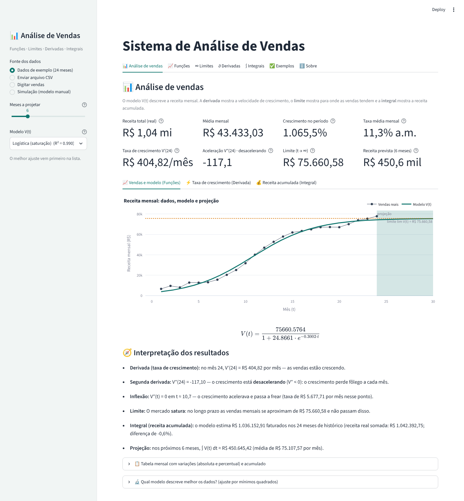
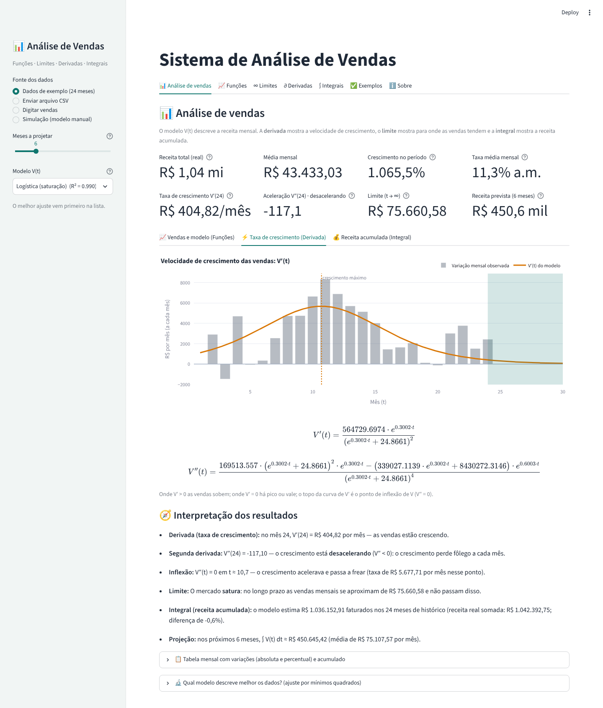
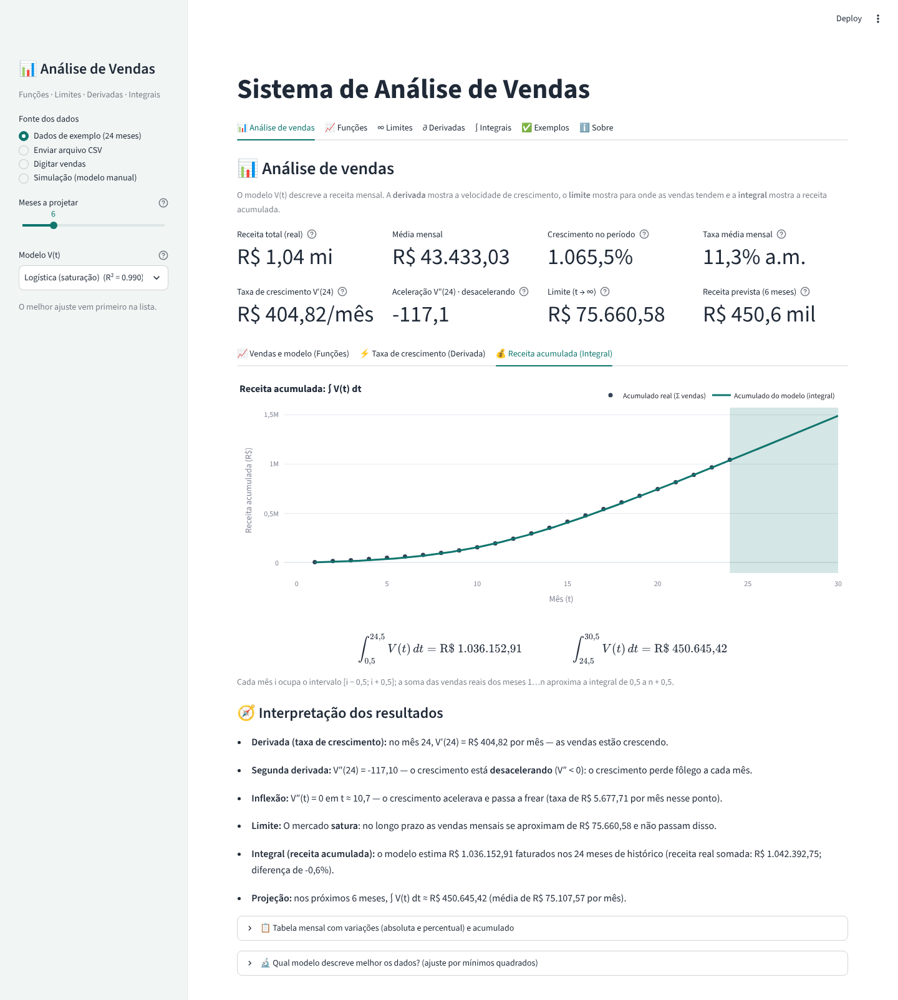
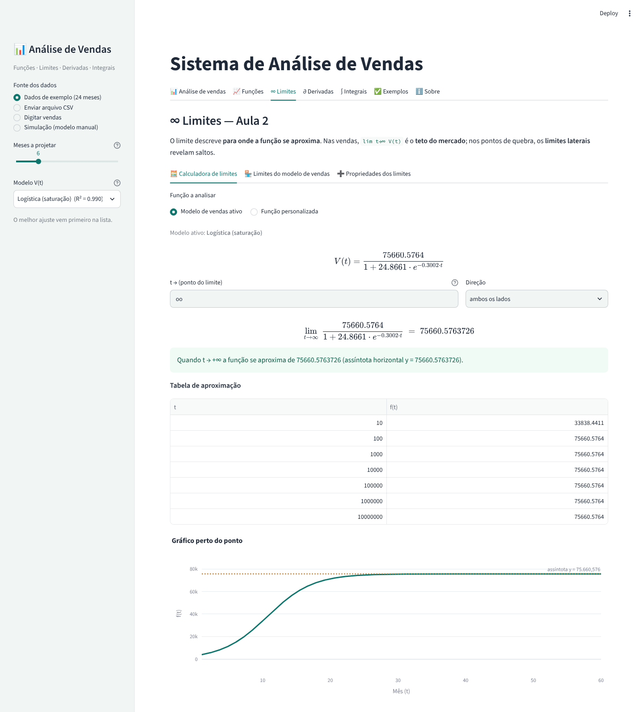

# 📊 Sistema de Análise de Vendas

**Projeto Final de Cálculo Diferencial e Integral (CDI) — AP2**
UNICATÓLICA RN · Engenharia de Software · 2026.2

| | |
|---|---|
| **Integrantes** | `[PREENCHER: nome completo de cada integrante]` |
| **Turma** | `[PREENCHER: A ou B]` |
| **Tecnologia** | Python 3 · Streamlit · SymPy · NumPy/SciPy · Pandas · Plotly |
| **Execução** | `streamlit run app.py` (aplicativo web local) |

---

## 1. Problema e objetivos

**Problema.** Uma empresa quer entender como suas vendas crescem: *qual curva descreve esse crescimento? com que velocidade ele acontece (e está acelerando ou freando)? o mercado tem um teto? quanto vamos faturar nos próximos meses?*

**Objetivo.** Construir uma aplicação funcional que responda a essas perguntas usando os quatro conteúdos de CDI, com cálculos verificáveis e interpretação em linguagem de negócio:

| Conteúdo | Pergunta de negócio | Ferramenta no sistema |
|---|---|---|
| **Funções** (Aula 1) | Que curva descreve as vendas? | 6 tipos de função ajustados aos dados |
| **Limites** (Aula 2) | O mercado tem um teto? Há quebras? | `lim t→∞ V(t)`, limites laterais, continuidade |
| **Derivadas** (Aula 3) | Quão rápido (e acelerando?) crescemos? | `V′(t)` e `V″(t)` com 13 regras |
| **Integrais** (Aula 4) | Quanto faturamos / vamos faturar? | `∫ V(t) dt` com 11 regras |

`V(t)` é a **receita mensal (R$) no mês t**. Entrada do sistema: histórico de vendas (CSV, digitado ou simulado). Saída: gráficos, indicadores e um texto interpretando cada resultado.

## 2. Capturas de tela

| Painel de análise | Taxa de crescimento (derivada) |
|---|---|
|  |  |

| Receita acumulada (integral) | Limites |
|---|---|
|  |  |

Mais capturas em [`docs/capturas/`](docs/capturas): Funções, Derivadas, Integrais e Exemplos verificáveis.

## 3. Instalação e execução

Requer **Python 3.10 ou superior**.

```bash
# 1. clonar o repositório
git clone https://github.com/<seu-usuario>/sistema-analise-vendas-cdi.git
cd sistema-analise-vendas-cdi

# 2. (recomendado) criar ambiente virtual
python -m venv .venv
source .venv/bin/activate        # Windows: .venv\Scripts\activate

# 3. instalar dependências
pip install -r requirements.txt

# 4. rodar o aplicativo (abre em http://localhost:8501)
streamlit run app.py
```

Outros comandos úteis:

```bash
python scripts/demo_terminal.py     # demonstração dos 4 módulos no terminal (sem interface)
pytest                              # 265 testes automatizados
python scripts/gerar_dados_exemplo.py   # regenera dados/vendas_exemplo.csv
```

**Como usar o aplicativo**

1. Na **barra lateral** escolha a fonte dos dados: *exemplo (24 meses)*, *arquivo CSV* (colunas `mes` e `vendas`), *vendas digitadas* ou *simulação* (você escolhe o tipo de função e os parâmetros).
2. A aba **Análise de vendas** mostra indicadores, três gráficos e a interpretação em português.
3. As abas **Funções, Limites, Derivadas e Integrais** permitem explorar cada conteúdo com o modelo ativo **ou com uma função digitada por você** (ex.: `3*t^2 + sin(t)`).
4. A aba **Exemplos** executa, ao vivo, contas com resposta calculada à mão.

## 4. Arquitetura

```
sistema-analise-vendas-cdi/
├── app.py                      # ponto de entrada: barra lateral + abas
├── interface/                  # camada de apresentação (Streamlit), uma página por aba
│   ├── componentes.py          #   contexto, gráficos, formatação, tratamento de erros
│   ├── pagina_vendas.py        #   painel integrado
│   ├── pagina_funcoes.py · pagina_limites.py · pagina_derivadas.py · pagina_integrais.py
│   └── pagina_exemplos.py · pagina_sobre.py
├── vendas_cdi/                 # camada de cálculo (sem dependência do Streamlit)
│   ├── validacao.py            #   validação de números, intervalos e expressões digitadas
│   ├── funcoes.py              #   Aula 1: 6 tipos, domínio, imagem, tabela
│   ├── limites.py              #   Aula 2: limites, laterais, continuidade, propriedades
│   ├── derivadas.py            #   Aula 3: motor de regras com passo a passo
│   ├── integrais.py            #   Aula 4: motor de regras, integral definida, Riemann
│   ├── dados.py                #   leitura de CSV, variações, ajuste de modelos
│   ├── analise.py              #   relatório que junta os 4 módulos
│   └── exemplos.py             #   exemplos verificáveis (usados pela aba e pelos testes)
├── tests/                      # 265 testes (pytest)
├── dados/vendas_exemplo.csv    # 24 meses de uma loja virtual fictícia
├── scripts/                    # demo no terminal, gerador de dados, gerador de capturas
└── docs/capturas/              # imagens usadas neste README
```

**Fluxo de dados:** `CSV/digitação → validacao → dados (variações + ajuste) → modelo V(t) → limites · derivadas · integrais → analise (texto) → interface (gráficos)`.

A camada de cálculo **não importa Streamlit**: pode ser usada e testada sozinha (veja `scripts/demo_terminal.py`).

## 5. Os quatro conteúdos e as justificativas matemáticas

### 5.1 Funções (Aula 1) — 6 tipos distintos

Convenção: **entrada** = mês `t`; **saída** = receita mensal `V(t)` em R$.

| Tipo | Fórmula | Domínio | Imagem | Situação de vendas |
|---|---|---|---|---|
| Afim (linear) | `V = a·t + b` | ℝ | ℝ (se a ≠ 0) | crescimento constante |
| Quadrática | `V = a·t² + b·t + c` | ℝ | `[vértice, ∞)` ou `(−∞, vértice]` | acelera ou atinge um pico |
| Exponencial | `V = a·e^(k·t)` | ℝ | `(0, ∞)` | crescimento composto |
| Logarítmica | `V = a·ln(t+1) + b` | `(−1, ∞)` (usamos t ≥ 0) | ℝ | cresce e desacelera |
| Logística | `V = L / (1 + e^(−k(t−t₀)))` | ℝ | `(0, L)` | curva em S, saturação |
| Sazonal | `V = c + a·t + A·sen(2πt/P + φ)` | ℝ | ℝ (ou `[c−A, c+A]` se a = 0) | tendência + sazonalidade |

Cada tipo exibe fórmula, classificação, domínio e imagem teóricos, imagem numérica no intervalo, **gráfico e tabela de entradas/saídas**. Funções digitadas pelo usuário têm o domínio calculado simbolicamente (`continuous_domain` do SymPy).

### 5.2 Limites (Aula 2)

Implementado em `limites.py`:

- **Limites laterais** `t→a⁻` e `t→a⁺` (sempre calculados em pontos finitos) e **limite bilateral**, que só existe se os laterais coincidem.
- **Limites no infinito** e **limites infinitos** (assíntotas horizontais e verticais).
- **Casos de inexistência** identificados e explicados: salto (`|t|/t` em 0: laterais −1 e +1), laterais infinitos de sinais opostos (`1/t` em 0), oscilação (`sen t` quando t→∞).
- **Continuidade** em um ponto (as três condições: f(a) definida, limite existe, f(a) = limite) com classificação da descontinuidade: removível, de salto, infinita ou oscilante.
- **Propriedades dos limites** (soma, diferença, produto, constante, quociente) conferidas na aba *Propriedades dos limites*.
- **Tabela de aproximação** numérica e gráfico perto do ponto.

**Interpretação no projeto:**

- `lim t→∞ V(t)` = **teto do mercado** (para a logística vale `L`).
- `lim t→∞ V′(t)/V(t)` = crescimento percentual de longo prazo.
- `lim h→0 [V(t₀+h) − V(t₀)]/h` = **a própria definição de derivada**: o sistema calcula `V′(t₀)` pelo limite e pelas regras e mostra que coincidem.

### 5.3 Derivadas (Aula 3) — 13 regras

`derivadas.py` **não usa `sympy.diff` para obter o resultado**: ele desce pela expressão aplicando cada regra e registra o passo a passo (só formas fora das regras, como `tᵗ`, caem num recurso do SymPy e aparecem como "Outra (SymPy)"). `sympy.diff` e a diferença finita central `(f(t+h) − f(t−h))/2h` são usados **apenas para conferir** — duas verificações independentes em cada cálculo.

| Regra | Fórmula | Exemplo (calculado pelo sistema) |
|---|---|---|
| Constante | `(c)′ = 0` | `5000 → 0` |
| Potência | `(tⁿ)′ = n·tⁿ⁻¹` | `t³ → 3t²` |
| Constante × função | `(c·f)′ = c·f′` | `4t² → 8t` |
| Soma/Subtração | `(f ± g)′ = f′ ± g′` | `t² + 3t − 7 → 2t + 3` |
| Produto | `(f·g)′ = f′g + fg′` | `t²eᵗ → t(t+2)eᵗ` |
| Quociente | `(f/g)′ = (f′g − fg′)/g²` | `t/(t+1) → 1/(t+1)²` |
| Cadeia | `(f(g))′ = f′(g)·g′` | `(3t+1)⁵ → 15(3t+1)⁴` |
| Exponencial | `(eᵘ)′ = eᵘ·u′` | `e^(2t) → 2e^(2t)` |
| Logaritmo natural | `(ln u)′ = u′/u` | `ln(t²+1) → 2t/(t²+1)` |
| Seno | `(sen u)′ = cos u·u′` | `sen(2t) → 2cos(2t)` |
| Cosseno | `(cos u)′ = −sen u·u′` | `cos t → −sen t` |
| Tangente | `(tg u)′ = sec²u·u′` | `tg(3t) → 3/cos²(3t)` |
| Módulo | `(\|u\|)′ = sinal(u)·u′` | `\|t−2\| → sinal(t−2)` |

**Interpretação no projeto:**

- `V′(t) > 0` → vendas subindo; `V′(t) = 0` → **pico ou vale**; `V′(t) < 0` → vendas caindo.
- `V″(t) > 0` → crescimento **acelerando**; `V″(t) < 0` → **desacelerando**.
- `V″(t) = 0` com troca de sinal → **ponto de inflexão** (mês de maior ou menor taxa de crescimento). Para a logística, a inflexão ocorre em `t = t₀` e a taxa máxima vale `L·k/4` — resultado que os testes confirmam.

### 5.4 Integrais (Aula 4) — 11 regras

Mesmo princípio: `integrais.py` aplica as regras e registra os passos; `sympy.integrate` é usado só quando nenhuma regra própria cabe (e o relatório diz "Outra (SymPy)"). Toda antiderivada é **conferida derivando-a de volta** (`d/dt F = f`), e toda integral definida é conferida contra a integração numérica `scipy.integrate.quad`.

| Regra | Fórmula | Exemplo |
|---|---|---|
| Constante | `∫c dt = c·t` | `∫5 dt = 5t` |
| Potência | `∫tⁿ dt = tⁿ⁺¹/(n+1)` | `∫t³ dt = t⁴/4` |
| 1/t | `∫(1/t) dt = ln\|t\|` | `∫1/t dt = ln\|t\|` |
| Soma/Subtração | `∫(f ± g) = ∫f ± ∫g` | `∫(3t²+2t+1) dt = t³+t²+t` |
| Constante × função | `∫c·f = c·∫f` | `∫6t² dt = 2t³` |
| Exponencial | `∫e^(kt) dt = e^(kt)/k` | `∫e^(2t) dt = e^(2t)/2` |
| Seno | `∫sen(kt) dt = −cos(kt)/k` | `∫sen(3t) dt = −cos(3t)/3` |
| Cosseno | `∫cos(kt) dt = sen(kt)/k` | `∫cos(2t) dt = sen(2t)/2` |
| Substituição linear | `u = at+b ⇒ ∫f(at+b) dt = F(at+b)/a` | `∫(2t+1)³ dt = (2t+1)⁴/8` |
| Substituição `u = eᵍ` | `∫dt/(1+eᵍ) = t − ln(1+eᵍ)/g′` | `∫1/(1+e^(−t)) dt = ln(1+eᵗ)` |
| Por partes | `∫u dv = uv − ∫v du` | `∫t·eᵗ dt = (t−1)eᵗ` |

A **integral definida** usa o Teorema Fundamental: `∫ₐᵇ f dt = F(b) − F(a)`. A aba também mostra o **valor médio** `(1/(b−a))∫f dt` e as **somas de Riemann** convergindo para a integral — a integral como *limite*, ligando de volta ao módulo de limites.

**Interpretação no projeto:** `∫ V(t) dt` é a **receita acumulada**.
*Convenção:* o mês `i` é representado por `t = i` e ocupa o intervalo `[i−½, i+½]`. Como cada intervalo tem largura 1 e `V(i)` é o valor no ponto médio, a soma das vendas mensais `ΣV(i)` é exatamente uma soma de Riemann (ponto médio) de `∫ V(t) dt`; por isso o gráfico compara o acumulado real com a integral do modelo.

### 5.5 Como os módulos se combinam: ajuste do modelo

Com dados reais, `dados.py` ajusta cada tipo de função por **mínimos quadrados** (reta, parábola e logarítmica por regressão linear; exponencial por regressão de `ln V`; logística por `scipy.optimize.curve_fit`; sazonal por mínimos quadrados em `[1, t, sen, cos]`) e escolhe o melhor pelo **R² ajustado**, que penaliza modelos com mais parâmetros. O usuário pode trocar o modelo na barra lateral. O modelo escolhido alimenta limites, derivadas e integrais.

## 6. Exemplos de entrada e saída

**Entrada (CSV)** — arquivo `dados/vendas_exemplo.csv`:

```csv
mes,vendas
2025-01,6675.36
2025-02,9586.98
2025-03,8117.9
...
```

Aceita separador `,` `;` ou tab, decimal brasileiro (`1.234,56`) ou internacional (`1234.56`) e a coluna `mes` é opcional. *Convenção:* um ponto seguido de **exatamente três dígitos** (`1.200`) é lido como separador de milhar (1200).

**Saída** (trecho de `python scripts/demo_terminal.py`):

```text
Melhor modelo: Logística (saturação) (R² = 0.9901)
• Derivada: no mês 24, V′(24) = R$ 404,82 por mês — as vendas estão crescendo.
• Segunda derivada: V″(24) = -117,10 — o crescimento está desacelerando.
• Inflexão: V″(t) = 0 em t ≈ 10,7 — o crescimento acelerava e passa a frear (R$ 5.677,71 por mês).
• Limite: O mercado satura: as vendas mensais se aproximam de R$ 75.660,58 e não passam disso.
• Integral: o modelo estima R$ 1.036.152,91 nos 24 meses (real: R$ 1.042.392,75; diferença de -0,6%).
• Projeção: nos próximos 6 meses, ∫ V(t) dt ≈ R$ 450.645,42.
```

**Exemplos de cada módulo com resposta conferível à mão** (também na aba *Exemplos* — 69 linhas — e em `vendas_cdi/exemplos.py`):

| Módulo | Cálculo | Resultado esperado (conta) |
|---|---|---|
| Funções | `V(t) = 100·e^(t·ln 2)` em `t = 3` | `800` (= 100·2³) |
| Funções | `V = 100/(1 + e^(−0,5(t−10)))` em `t = 10` | `50` (ponto de inflexão = L/2) |
| Limites | `lim t→2 (t²−4)/(t−2)` | `4` (fatora em `t+2`) |
| Limites | `lim t→0 \|t\|/t` | **não existe** (laterais −1 e +1) |
| Limites | `lim t→∞ 100/(1 + e^(−0,5(t−10)))` | `100` |
| Derivadas | `V = −25t² + 1500t + 20000`, `V′(10)` | `1000` (= −50·10 + 1500) |
| Derivadas | mesmo modelo, `V′(t) = 0` | `t = 30` (pico de R$ 42.500) |
| Integrais | `∫₀³ t² dt` | `9` (= 27/3) |
| Integrais | `∫₀¹ t·eᵗ dt` (por partes) | `1` |
| Integrais | receita em 12 meses de `V = 1000t + 5000` | `138.000` (= Σ(1000i + 5000), i = 1…12) |

## 7. Tratamento de entradas inválidas

Toda entrada passa por `vendas_cdi/validacao.py`; erros viram mensagens em português na tela (`⚠️ ...`), nunca um erro técnico.

| Entrada inválida | Comportamento |
|---|---|
| Parâmetro vazio, texto, `NaN` ou `∞` | recusado com o nome do parâmetro |
| Restrição matemática (`a ≤ 0` na exponencial, `L ≤ 0` ou `k ≤ 0` na logística, período < 2) | recusado explicando a regra |
| Intervalo invertido ou vazio (`[10, 2]`) | recusado |
| Função digitada com sintaxe errada, identificador desconhecido ou código (`__import__('os')`, `t.__class__`) | recusado **antes** de chegar ao interpretador (lista de nomes permitidos) |
| Potências gigantes (`9^9^9`, `t^5000`), expressão com mais de 200 caracteres | recusado (evita travar o computador) |
| Ponto de limite inválido (`banana`, `2 3`, `1/0`) | recusado |
| Integral ou derivada onde a função não existe (`∫ 1/(t−5)` em `[0,10]`, `ln` de negativo) | recusado explicando que o intervalo sai do domínio |
| Limite que não existe, assíntota, oscilação | **não é erro**: é um resultado, explicado na tela |
| CSV vazio, sem coluna `vendas`, com texto, vazio ou negativo, com menos de 6 meses ou maior que 2 MB | recusado indicando a linha do arquivo |
| Função sem antiderivada em forma fechada | aviso + integral definida calculada numericamente |

## 8. Testes e verificação

```bash
pytest          # 265 testes, ~1 min
```

| Arquivo | O que verifica |
|---|---|
| `test_funcoes.py` | valores calculados à mão, domínio/imagem, parâmetros inválidos |
| `test_limites.py` | limites finitos, infinitos, laterais, inexistência, continuidade, propriedades |
| `test_derivadas.py` | cada uma das 13 regras contra `sympy.diff` **e** diferença finita; pico e inflexão |
| `test_integrais.py` | cada uma das 11 regras (`d/dt F = f`); integrais definidas contra `scipy.quad`; Riemann |
| `test_dados.py` | CSV válidos/inválidos; o ajuste **recupera os parâmetros** de dados sintéticos |
| `test_analise_e_exemplos.py` | relatório integrado e os 69 exemplos verificáveis |
| `test_validacao.py` | entradas maliciosas e inválidas |
| `test_interface.py` | o aplicativo abre, troca de modo e recusa entradas inválidas sem quebrar |

## 9. Decisões e limitações (leia antes de apresentar)

- **O modelo é uma aproximação.** O ajuste usa 6 famílias de curvas; com poucos meses ou dados muito irregulares o "melhor modelo" pode ser enganoso. O R² ajustado ajuda, mas não substitui julgamento.
- **Projeções são extrapolações.** A projeção de 6 meses só vale se o comportamento recente continuar. O modelo exponencial, por exemplo, cresce sem limite e raramente serve para horizontes longos.
- **Sazonalidade com período fixo de 12 meses** no ajuste automático (precisa de ≥ 12 meses de dados). Na simulação manual o período é livre.
- **Regras próprias + SymPy.** As regras de derivação/integração são implementadas no código; expressões fora delas (ex.: `e^(−t²)`) usam `sympy.integrate` e aparecem como "Outra (SymPy)".
- **Convenção do separador de milhar** em CSV (`1.200` → 1200) pode divergir de planilhas em formato inglês; confira a tabela mensal após enviar o arquivo.
- Os dados de exemplo são **fictícios** (gerados por `scripts/gerar_dados_exemplo.py`).

## 10. Registro de uso de IA

> Exigido pelo guia da AP2: ferramenta, objetivo, texto do prompt, resultado, ajustes e validação humana.

**Declaração:** este projeto foi desenvolvido com auxílio de IA generativa, conforme registro abaixo.

### Registro 1 — Geração da base do projeto

| Campo | Conteúdo |
|---|---|
| **Ferramenta** | Claude (Anthropic) — modelo Claude Sonnet 5.5 |
| **Objetivo** | Gerar a base completa do projeto: arquitetura, módulos de cálculo, interface, testes e documentação |
| **Prompt** | Enviado o guia da AP2 (PDF) junto com: *"Qual é o objetivo do projeto? […] baseado nisso, crie um: Sistema de análise de vendas — Uma aplicação que analisa o crescimento das vendas de uma empresa, calcula variações, tendências e acumulação de receitas."* |
| **Resultado** | Este repositório: pacote `vendas_cdi/` (cálculo), `interface/` (Streamlit), `tests/`, `scripts/`, dados de exemplo e este README |
| **Ajustes feitos durante a geração** | Bugs encontrados pelos testes e corrigidos: `derivada_numerica` aceitava ponto fora do domínio; o `simplify` do SymPy gerava `log(u**250000)` numericamente instável na antiderivada da logística (criado `simplificar_seguro`); funções especiais (`erf`) quebravam o `lambdify` com arrays; "2 3" era lido como 23 em pontos de limite; parser de CSV confundia arquivos de uma coluna; decimais longos apareciam como frações gigantes em limites |
| **Validação automatizada** | 265 testes passando; 69 exemplos com resposta calculada à mão; código compilado em Python 3.11 e executado em 3.13; capturas de tela conferidas visualmente |
| **Validação humana** | `[PREENCHER pelos integrantes — veja o checklist abaixo]` |

**Checklist de validação humana (cada integrante deve fazer e registrar):**

- [ ] Rodei `streamlit run app.py` e naveguei por todas as abas.
- [ ] Refiz **à mão** pelo menos 3 cálculos da tabela da seção 6 e conferi com o sistema: `[quais?]`
- [ ] Li `derivadas.py` e `integrais.py` e consigo explicar como cada regra é aplicada.
- [ ] Consigo explicar por que `V′` é a taxa de crescimento, por que `V″ = 0` marca a inflexão e por que a integral é a receita acumulada.
- [ ] Testei entradas inválidas e entendi as mensagens.
- [ ] Alterações que fiz sobre o código gerado: `[descrever]`

### Registros seguintes

Copie a tabela acima para cada novo uso de IA (novos prompts, correções, dúvidas), sempre com o texto real do prompt e o que foi aceito, alterado ou rejeitado.

## 11. Histórico de commits (sugestão)

O guia pede **commits progressivos com mensagens descritivas**. Faça os commits à medida que estudar e entender cada parte, não tudo de uma vez. Uma sequência possível:

```text
1. chore: estrutura inicial, requirements e .gitignore
2. feat(validacao): validação de números, intervalos e expressões digitadas
3. feat(funcoes): seis tipos de função com domínio, imagem e tabela (Aula 1)
4. feat(derivadas): motor de regras de derivação com passo a passo (Aula 3)
5. feat(limites): limites laterais, no infinito, continuidade e propriedades (Aula 2)
6. feat(integrais): motor de regras de integração e integral definida (Aula 4)
7. feat(dados): leitura de CSV, variações e ajuste de modelos por mínimos quadrados
8. feat(analise): relatório integrado com interpretação em português
9. feat(interface): aplicativo Streamlit com painel e abas dos quatro módulos
10. test: testes automatizados dos módulos e da interface
11. docs: README, capturas de tela e registro de uso de IA
```

## 12. Publicar no GitHub

```bash
git init
git add .
git commit -m "chore: estrutura inicial do projeto"   # ...e siga com commits menores
git branch -M main
git remote add origin https://github.com/<seu-usuario>/sistema-analise-vendas-cdi.git
git push -u origin main
```

Envie o **link do repositório** no Google Classroom até a data da sua turma (Turma B: 30/11/2026 · Turma A: 03/12/2026). Se o repositório for privado, dê acesso à professora.
